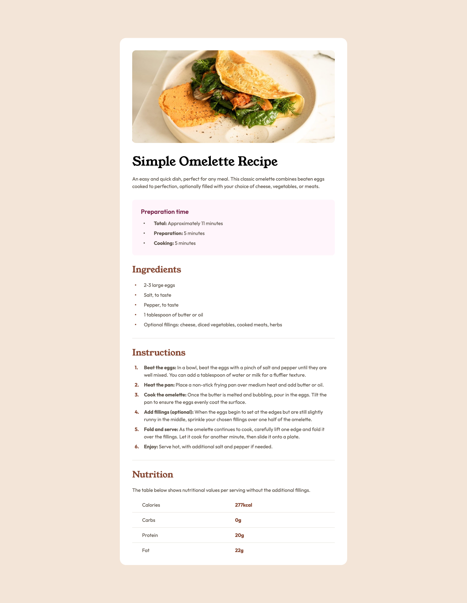

# Frontend Mentor - Recipe page solutions

This is a solution to the [Recipe page challenge on Frontend Mentor](https://www.frontendmentor.io/challenges/recipe-page-KiTsR8QQKm). Frontend Mentor challenges help you improve your coding skills by building realistic projects. 

## Table of contents

- [Overview](#overview)
  - [The challenge](#the-challenge)
  - [Screenshot](#screenshot)
  - [Links](#links)
- [My process](#my-process)
  - [Built with](#built-with)
  - [What I learned](#what-i-learned)
  - [Continued development](#continued-development)
  - [Useful resources](#useful-resources)
  - [AI Collaboration](#ai-collaboration)
- [Author](#author)

## Overview

### The challenge

Your challenge is to build out this recipe page and get it looking as close to the design as possible.

You can use any tools you like to help you complete the challenge. So if you've got something you'd like to practice, feel free to give it a go.

### Screenshot


### Links

- Solution URL: [Add solution URL here](https://your-solution-url.com)
- Live Site URL: [Add live site URL here](https://your-live-site-url.com)

## My process

### Built with

- Semantic HTML5 markup
- CSS custom properties
- Flexbox
- CSS Grid
- Mobile-first workflow

### What I learned

i'm learning how to create table layouts in CSS
```css
table {
  font-family: var(--font-body);
  ....
}
```

```css
table td {
  font-weight: var(--fw-bold);
  color: var(--brown-800);
  ... 
}
```

select specific element
```css
table tr:last-child th,
table tr:last-child td {
  border-bottom: none;
}
```
### Continued development

Focusing on developing skills by using new languages such as Javascript and it's libraries, also starting to get into back-end development.

as part of the process of learing good coding practice for future development.

### Useful resources

- [mdn]([https://www.example.com](https://developer.mozilla.org/en-US/)) - This helped me for determination of the properties used

### AI Collaboration

Tools AI : Gemini 3.1 Flash-Lite

For this project, I leveraged AI as a collaborative tool to resolve coding challenges through conceptual analogies. Specifically, I utilized it for:

1. Defining the initial development workflow and priorities.
2. Brainstorming architectural and logic-based solutions.
3. Identifying tools to ensure design fidelity and alignment with project specifications."
4. asking whether this code is well-written and to parform a final check

## Author

- GitHub - [haidan-0e](https://github.com/haidan-0e)
- Frontend Mentor - [@haidan-0e](https://www.frontendmentor.io/profile/haidan-0e)

